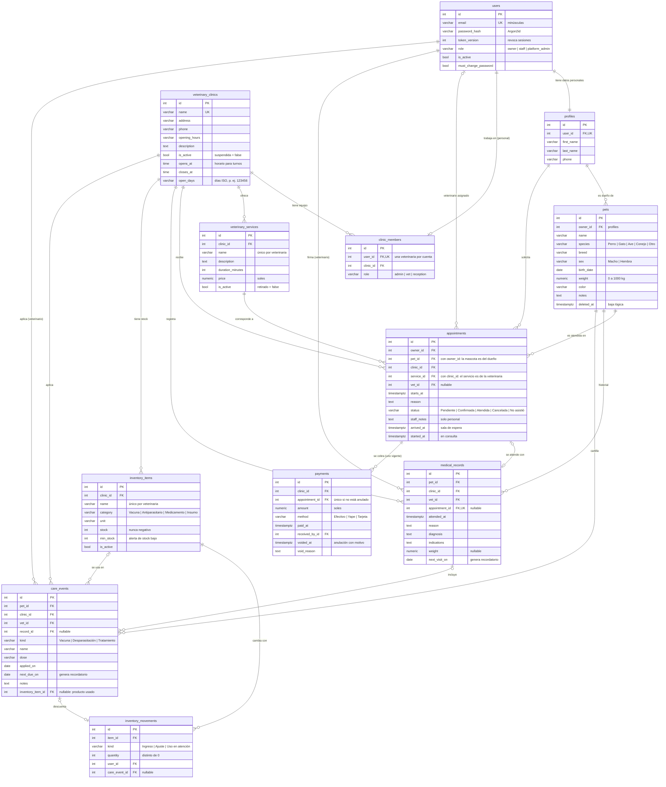

# Modelo de datos (diagrama entidad-relación)

PostgreSQL 17 (Supabase en producción). Fuente de verdad: [`backend/app/models.py`](../backend/app/models.py) y las migraciones de Alembic (`0001`, `0002`, `0003`). Todas las tablas tienen `created_at` y `updated_at`; se omiten en el diagrama.

## Equivalencia con el diagrama de clases del Avance 2

| Avance 2 (PDF) | Implementación | Cambio y motivo |
|---|---|---|
| Propietario | `users` + `profiles` | Se separan credenciales y datos personales. `profiles` también sirve al personal, así la persona y su cuenta son una sola entidad para todos los roles |
| — | `clinic_members` | Nuevo: vincula al personal con su veterinaria y su rol (admin, veterinario, recepción) |
| Veterinaria | `veterinary_clinics` | Se añade `is_active` para suspender una veterinaria sin perder su historial |
| ServicioVeterinario | `veterinary_services` | Se añade `is_active`: un servicio retirado se oculta, pero sigue en citas pasadas |
| Mascota | `pets` | Baja lógica (`deleted_at`) para no perder historial; el estado del PDF se cubre con esa baja |
| Cita | `appointments` | Fecha y hora unidas en `starts_at` con zona horaria; flujo de estados ampliado; veterinario asignado y notas internas |
| Historial_Vet | `medical_records` | Vinculado a la veterinaria, al veterinario que firma y, opcionalmente, a la cita (1 a 1) |
| Tratamiento | `care_events` | Unifica vacunas, desparasitaciones y tratamientos con `kind`. `next_due_on` alimenta los recordatorios |

## Reglas de integridad en la base de datos

- **Claves foráneas compuestas** en `appointments`: `(pet_id, owner_id) → pets` y `(service_id, clinic_id) → veterinary_services`. La base rechaza una cita con una mascota ajena o un servicio de otra veterinaria, aunque falle la validación de la API.
- **CHECK** en roles, estados, especies, sexo, peso, precio, duración, `next_due_on ≥ applied_on`, horario (`closes_at > opens_at`), `started_at` solo con `arrived_at`, métodos de pago, stock no negativo y movimientos distintos de cero.
- **Índice único parcial** `uq_payment_appointment_valid`: una cita tiene como máximo un cobro no anulado.
- **ON DELETE RESTRICT** en todas las relaciones: nada clínico se borra en cascada.
- **Índices** para la agenda (`clinic_id, starts_at`), las citas del propietario (`owner_id, status, starts_at`) y los recordatorios (`pet_id, next_due_on`).
- **Trigger** `vetgest_touch_updated_at` mantiene `updated_at` aunque se actualice fuera de SQLAlchemy.
- **Supabase:** RLS activado sin políticas y permisos revocados a `anon` y `authenticated`. Solo el backend accede a los datos.
